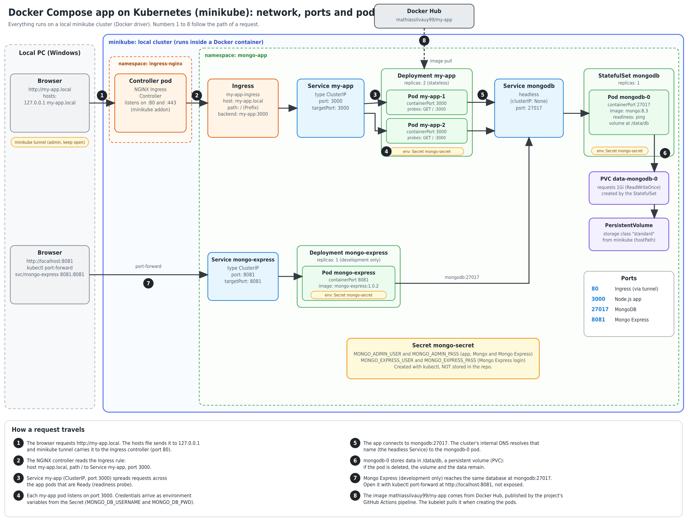
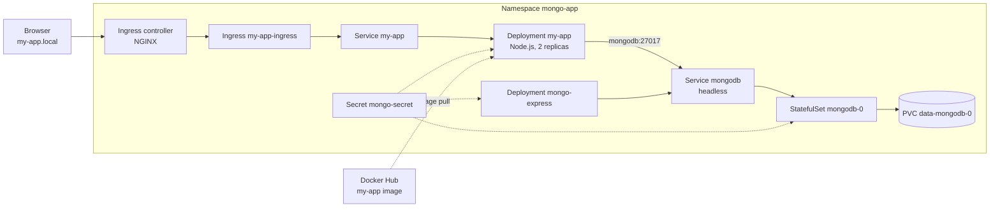
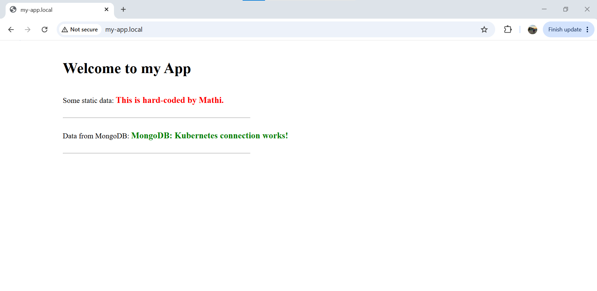
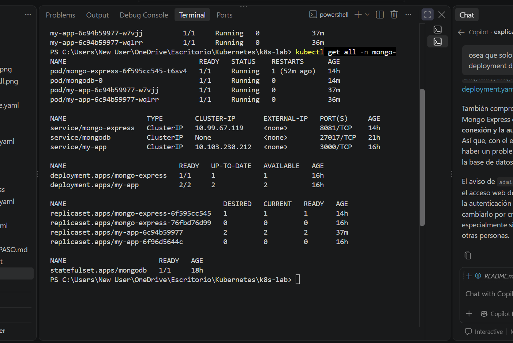
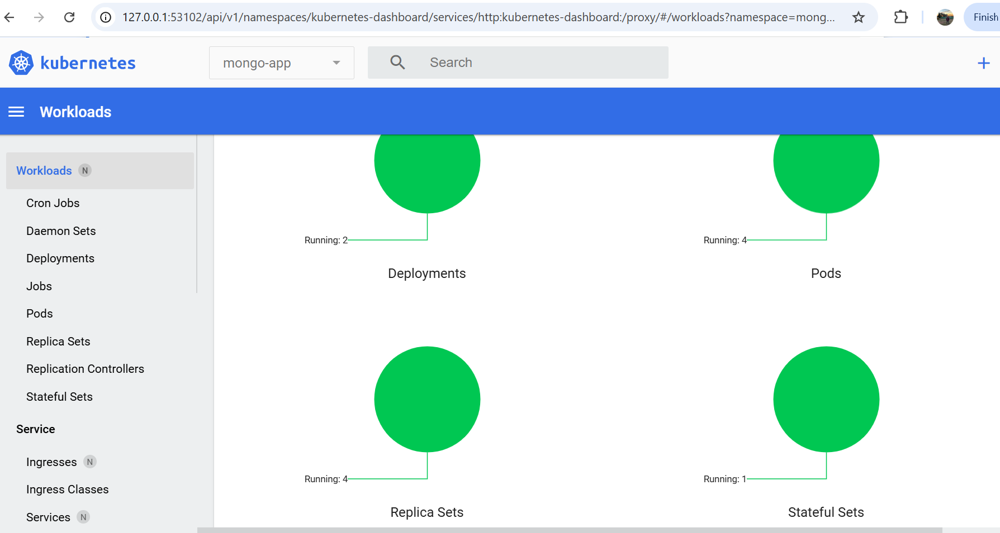
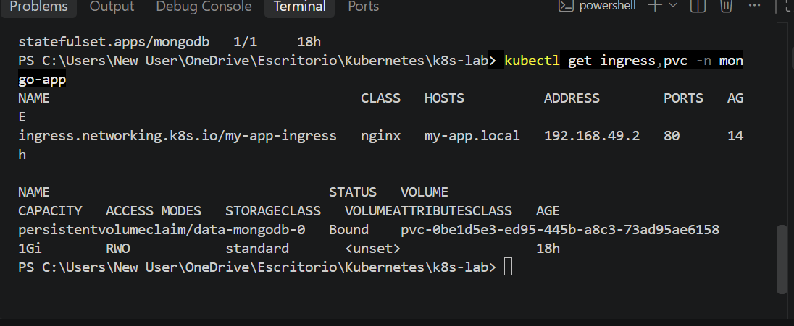

# Docker Compose App Migrated to Kubernetes (minikube)

My Node.js + MongoDB application, previously run with Docker Compose ([Lab-Docker-Workflow](https://github.com/masr99uy-cloud-labs/Lab-Docker-Workflow)), now running on a local Kubernetes cluster with **minikube**. The application image is the one built and published to Docker Hub by the GitHub Actions workflow of that project.

> **Note:** I built this project after following the four-hour Kubernetes course by TechWorld with Nana, plus other online material. I had already used Claude and ChatGPT in my previous projects. For this one I also added GitHub Copilot for code-level help and to troubleshoot connectivity between the cluster components (for example, the Ingress setup on minikube with the Docker driver on Windows). AI assistants helped me draft and debug the manifests, but I ran and tested everything myself on my own cluster and made sure I understood each command and resource. AI support is a great tool, but understanding what you run matters even more.

## Architecture





| Resource | Kind | Purpose |
|---|---|---|
| `mongo-app` | Namespace | Groups everything for this project |
| `mongo-secret` | Secret | Credentials for MongoDB and Mongo Express (created with `kubectl`, not stored in the repo) |
| `mongodb` | StatefulSet + headless Service | MongoDB with a persistent volume (`volumeClaimTemplates`) |
| `my-app` | Deployment (2 replicas) + Service | The Node.js app, with readiness and liveness probes and resource limits |
| `my-app-ingress` | Ingress | Routes `my-app.local` to the app through the NGINX ingress controller |
| `mongo-express` | Deployment + Service | Web UI to inspect the database (development only) |

## Repository structure

```
k8s/
  namespace.yaml
  mongo/          StatefulSet and headless Service for MongoDB
  app/            Deployment and Service for the Node.js app
  ingress/        Ingress for the Node.js app
  mongo-express/  Deployment and Service for Mongo Express
examples/
  secret.example.yaml   Example only (fake values)
docs/                   Screenshots
```

## Run it locally

Requirements: Docker, [minikube](https://minikube.sigs.k8s.io/) and `kubectl`.

```bash
minikube start --driver=docker
minikube addons enable ingress

kubectl apply -f k8s/namespace.yaml

kubectl create secret generic mongo-secret -n mongo-app \
  --from-literal=MONGO_ADMIN_USER=admin \
  --from-literal=MONGO_ADMIN_PASS=<your-password> \
  --from-literal=MONGO_EXPRESS_USER=admin \
  --from-literal=MONGO_EXPRESS_PASS=<another-password>

kubectl apply -f k8s/mongo/
kubectl rollout status statefulset/mongodb -n mongo-app

kubectl apply -f k8s/app/
kubectl apply -f k8s/ingress/
kubectl apply -f k8s/mongo-express/
kubectl get all -n mongo-app     # my-app should show 2/2 pods
```

### Access the app through the Ingress

With the Docker driver, the minikube IP is not reachable from the host, so use a tunnel:

1. Add this line to your hosts file (`C:\Windows\System32\drivers\etc\hosts` on Windows, `/etc/hosts` on Linux and macOS):
   ```
   127.0.0.1 my-app.local
   ```
2. In a separate terminal (as administrator on Windows), keep this running:
   ```bash
   minikube tunnel
   ```
3. Open http://my-app.local

Mongo Express is not exposed through the Ingress (it is an admin tool); use port forwarding:

```bash
kubectl port-forward -n mongo-app svc/mongo-express 8081:8081   # http://localhost:8081
```

The database starts empty. You can populate it with the sample data using `mongosh` or directly through the Mongo Express web interface.

## Screenshots

 
 
 
 

## Design decisions

- **StatefulSet for MongoDB** with a `volumeClaimTemplate` to provide persistent storage and stable pod identity. MongoDB runs as a single instance, not as a replica set.
- **Headless Service named `mongodb`**, the same host name the app used in Docker Compose, so the app code did not change.
- **Credentials in a Secret** created with `kubectl`; the repository only contains an example with fake values.
- **Readiness and liveness probes and resource requests/limits** on the app and the database.
- **Two replicas of the app** (it is stateless), to show load balancing, self-healing and rolling updates. MongoDB stays as a single instance: a real replica set would need extra configuration, and setting `replicas: 2` on the StatefulSet would create two independent databases.
- **Services are internal (`ClusterIP`)**: only the app is exposed, through an **Ingress**; Mongo Express is reached with `kubectl port-forward`, like binding to `127.0.0.1` in Compose.
- **Mongo Express is for development only.** The official image is deprecated.

## Known limitations and next steps

- The image uses the `latest` tag; Although the CI pipeline already publishes commit-SHA-based image tags, the Kubernetes manifests still need to be updated to use immutable image versions.
- Secrets are only base64-encoded in Kubernetes, not encrypted by default.
- Turn MongoDB into a replica set (or use an operator) for high availability.
- Package everything as a **Helm chart** with configurable values.
- Add **Prometheus** monitoring.
- Add TLS to the Ingress and a CI job that tests the deployment in a temporary cluster.

## What I learned

Through this project, I gained hands-on experience with Kubernetes and learned how to deploy, configure, and manage a multi-container application.


Key learnings:

- **Kubernetes Architecture & Resources:** Understanding how Pods, Deployments, ReplicaSets, StatefulSets, Services, Namespaces, and Ingress work together.
- **Networking & Service Discovery:** Configuring ClusterIP and Headless Services, understanding internal DNS resolution, and exposing applications through an NGINX Ingress Controller.
- **Persistent Storage:** Using PersistentVolumeClaims and StatefulSets to provide persistent storage for MongoDB.
- **Configuration & Secrets Management:** Managing environment variables and Kubernetes Secrets.
- **Application Reliability:** Implementing readiness and liveness probes, resource requests and limits, and multiple application replicas.

- **Containerization & CI:** Building and publishing Docker images to Docker Hub through GitHub Actions, and rolling out a new image version in the cluster manually with `kubectl rollout restart`.
- **Troubleshooting:** Diagnosing and resolving networking, configuration, database connectivity, and application deployment issues.
- **Kubernetes Dashboard:** Monitoring and inspecting cluster resources through the Minikube Dashboard.
- **Working with AI tools:** I used Copilot to review and debug YAML, and validated each suggestion before applying it.

## Most Challenging Issue

One of the most challenging issues I faced was a database connectivity problem between Mongo Express and MongoDB.

Initially, everything seemed correctly configured: Kubernetes Services, Secrets, credentials, and environment variables. However, Mongo Express kept trying to connect to the wrong hostname.

After investigating the pod logs, inspecting the container environment variables, and reviewing the image documentation, I discovered that the Mongo Express image had a default `ME_CONFIG_MONGODB_URL` value that was not explicitly overridden in my Kubernetes manifest.

As a result, the container kept using its default MongoDB hostname instead of the `mongodb` Kubernetes Service.

The issue was resolved by explicitly defining the connection URL in the Deployment manifest.

**Key takeaway:** This taught me the importance of understanding container image defaults and troubleshooting beyond Kubernetes resources. Even when Services, credentials, and other Kubernetes objects appear correctly configured, an inherited default environment variable can cause unexpected connectivity issues.
